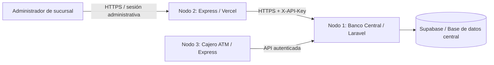

# Nodo 2 — Sucursal Bancaria

Sistema administrativo de sucursal para el **Examen Práctico: Sistema Bancario Distribuido**. Esta aplicación está desarrollada con **Node.js y Express** y se comunica con el **Nodo 1 (Banco Central, Laravel)** para registrar cuentas, consultar saldos, ejecutar transferencias y obtener información administrativa real.

**Aplicación desplegada:** https://banco-sucursal-five.vercel.app  
**Repositorio:** https://github.com/HUG004/banco-sucursal  
**Especificación de la API:** [`docs/openapi.yaml`](docs/openapi.yaml)

> El Nodo 2 no mantiene un saldo bancario independiente: las operaciones y consultas se delegan al Banco Central. Las respuestas y permisos dependen de la API central.

## Arquitectura



- **Nodo 1 — Banco Central:** autoridad sobre cuentas, saldos, movimientos y reportes; expone la API central y gestiona los datos persistentes.
- **Nodo 2 — Sucursal (este repositorio):** panel administrativo, autenticación, alta y consulta de cuentas, transferencias, historiales y reportes.
- **Nodo 3 — ATM:** operaciones de cajero, como consulta de saldo y retiro; se comunica con el Banco Central.

## Funcionalidades implementadas

- Inicio y cierre de sesión administrativa con cookie `HttpOnly` firmada mediante HMAC-SHA256.
- Registro de cuentas bancarias mediante el Banco Central.
- Consulta de saldos y transferencias.
- Consulta de datos de la sucursal autenticada.
- Historial de transacciones de la sucursal y de una cuenta específica.
- Reportes administrativos y búsqueda de cuentas.
- Endpoint de salud para verificar disponibilidad del servidor.

## Tecnologías

Node.js, Express 5, JavaScript, HTML, CSS, `cookie-parser`, `dotenv`, Git/GitHub y Vercel. La integración central utiliza la API HTTP de Laravel, que opera con la base de datos del sistema bancario.

## Requisitos e instalación

Se requiere Node.js compatible con `fetch` y `AbortSignal.timeout` (recomendado Node.js 20 o superior), npm y acceso autorizado al Banco Central.

```bash
git clone https://github.com/HUG004/banco-sucursal.git
cd banco-sucursal
npm ci
```

Crea un archivo `.env` en la raíz, **sin subirlo a GitHub**:

```dotenv
PORT=3002
BANCO_CENTRAL_URL=https://URL-DEL-BANCO-CENTRAL
BANCO_API_KEY=CLAVE-DEL-NODO-PROPORCIONADA-POR-EL-BANCO-CENTRAL
NODO_ID=IDENTIFICADOR-DE-LA-SUCURSAL
SUCURSAL_ADMIN_KEY=CLAVE-ADMINISTRATIVA-PRIVADA
SESSION_SECRET=SECRETO-ALEATORIO-DE-AL-MENOS-64-CARACTERES
```

`NODO_ID` se incluye para la configuración del nodo cuando corresponda; las peticiones mostradas en `BancoCentralClient.js` autentican al Banco Central mediante `BANCO_API_KEY`. Nunca incluyas valores reales de las claves en documentación, capturas o commits.

Para generar un secreto de sesión:

```bash
node -e "console.log(require('node:crypto').randomBytes(48).toString('hex'))"
```

Ejecuta:

```bash
npm start
# o, durante desarrollo:
npm run dev
```

Abre http://localhost:3002 y verifica la API:

```bash
curl -i http://localhost:3002/api/salud
```

El panel solicita la clave administrativa y utiliza una cookie de sesión para las operaciones protegidas.

## Endpoints del Nodo 2

| Método | Ruta | Función |
|---|---|---|
| GET | `/api/salud` | Estado del servidor |
| POST | `/api/auth/login` | Inicio de sesión administrativa |
| GET | `/api/auth/estado` | Estado de la sesión |
| POST | `/api/auth/logout` | Cierre de sesión |
| POST | `/api/banco/cuentas` | Registrar una cuenta en el Banco Central |
| GET | `/api/banco/saldo/{numeroCuenta}` | Consultar saldo |
| POST | `/api/banco/transferencias` | Realizar transferencia |
| GET | `/api/banco/sucursal` | Consultar información de la sucursal |
| GET | `/api/banco/sucursal/transacciones` | Historial de la sucursal |
| GET | `/api/banco/cuentas/{numeroCuenta}/transacciones` | Historial por cuenta |
| GET | `/api/banco/sucursal/reportes` | Reportes administrativos |
| GET | `/api/banco/cuentas/buscar?q=...` | Buscar cuentas |

Las rutas `/api/banco/*` requieren autorización de sucursal mediante sesión administrativa o el mecanismo autorizado por el middleware. El navegador no debe recibir `BANCO_API_KEY`; la comunicación con Laravel ocurre desde el servidor Express.

Para consultar el detalle de operaciones, parámetros y respuestas, consulta [`docs/openapi.yaml`](docs/openapi.yaml). Los campos de los cuerpos de registro y transferencia deben coincidir con los definidos en `src/controllers/bancoCentralController.js` y en la API del Banco Central.

## Integración con el Banco Central

El servicio `src/services/BancoCentralClient.js` centraliza las llamadas HTTP y agrega `X-API-Key` a las solicitudes salientes. La transferencia utiliza una clave de idempotencia para identificar reintentos; las peticiones pueden tener un tiempo de espera de 10 segundos.

El Nodo 2 consume las rutas del Nodo 1 `/api/accounts`, `/api/balance/{numeroCuenta}`, `/api/transfer`, `/api/nodes/me`, `/api/nodes/me/transactions`, `/api/accounts/{numeroCuenta}/transactions`, `/api/nodes/me/reports` y `/api/accounts/search`.

## Prueba de integración de los tres nodos

Se realizó una prueba conjunta del sistema distribuido:

1. **Sucursal (Nodo 2):** registro de una cuenta nueva con saldo inicial de **$1,000 MXN**.
2. **Banco Central (Nodo 1):** comprobación del saldo inicial de **$1,000 MXN**.
3. **ATM (Nodo 3):** retiro de **$300 MXN**.
4. **Banco Central (Nodo 1):** verificación del saldo final de **$700 MXN** y del movimiento correspondiente.

**Resultado esperado:** $1,000 − $300 = **$700 MXN**. Esta secuencia demuestra que los nodos consultan y modifican el estado bancario centralizado, en lugar de mantener saldos separados.

## Despliegue en Vercel

La aplicación está publicada en https://banco-sucursal-five.vercel.app. El servidor exporta la instancia Express desde `server.js` para permitir su ejecución en Vercel.

Para reproducir el despliegue, vincula el repositorio con Vercel y configura en **Settings → Environment Variables** las variables `BANCO_CENTRAL_URL`, `BANCO_API_KEY`, `SUCURSAL_ADMIN_KEY`, `SESSION_SECRET` y, cuando aplique, `NODO_ID`, en el entorno **Production**. Las variables nuevas requieren un nuevo despliegue para aplicarse. No publiques sus valores.

Tras desplegar, verifica `/api/salud`, el inicio de sesión y una consulta real al Banco Central.

## Seguridad y consideraciones

- Las credenciales del Banco Central se conservan exclusivamente en el servidor.
- El archivo `.env` está excluido mediante `.gitignore`.
- Las sesiones administrativas se firman con HMAC y tienen duración limitada.
- El login y logout comprueban el origen de la solicitud.
- Las operaciones monetarias se ejecutan en el Banco Central, no en memoria local.
- El historial de una sucursal puede no incluir operaciones realizadas por otro nodo (por ejemplo, el ATM); para verificar un retiro específico debe consultarse el historial de la cuenta y el registro central.

## Estructura principal

```text
banco-sucursal/
├── public/
│   ├── index.html
│   ├── css/styles.css
│   └── js/app.js
├── src/
│   ├── controllers/bancoCentralController.js
│   ├── middlewares/
│   │   ├── autorizacionSucursal.js
│   │   └── sesionAdministrativa.js
│   ├── routes/
│   │   ├── authRoutes.js
│   │   └── bancoCentralRoutes.js
│   └── services/BancoCentralClient.js
├── docs/openapi.yaml
├── server.js
├── package.json
└── README.md
```

**Proyecto académico:** Sistema Bancario Distribuido — Nodo 2, Sucursal Bancaria.
